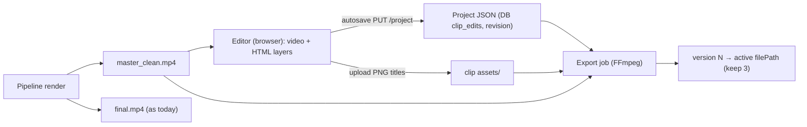

# Clip Editor v2 — Design Spec

- **Date:** 2026-10-29
- **Status:** Draft, waiting for user review
- **Scope:** Replace the subtitle-only modal (`ClipEditor.tsx`) with a full-screen editor that works like a simplified CapCut: trim and middle cuts, a v2 subtitle editor, trending TikTok/Shorts titles, image/video overlays, a cover thumbnail, and export with versioning.

## 1. Background and problems today

1. **Double-burn on re-render.** `POST /clips/{id}/render` (`backend/api/routes/editor.py`) takes `clip.filePath`, which is the final clip with subtitles already burned in. It then burns new subtitles on top and crops/re-encodes the already-processed clip again.
2. **The source video is deleted** after a job finishes (`shutil.rmtree(raw_dir)` in `pipeline.py`), so there is nothing to re-edit cleanly.
3. **Weak subtitle editing.** All words sit in one textarea and timings are matched by word order, so adding or removing a word breaks the timing. The preview plays the final mp4, so edits are not visible.

## 2. Agreed decisions

| Topic | Decision |
|---|---|
| Source for editing | Save a **clean master per clip** (crop/reframe applied, no subtitles/watermark) with **±3 s padding**, clamped to the source length |
| Preview | **HTML/CSS layers** on top of `<video>` master; FFmpeg is used only at export |
| Text rendering at export | **Hybrid:** titles/text stickers are drawn on a browser canvas as transparent PNGs and placed with `overlay`. Karaoke subtitles stay on **ASS/libass** |
| Layout | **Full-screen page:** tools left, preview center, properties right, timeline bottom |
| Trim | **In/out plus middle cuts** (multiple ranges). Layer timings follow automatically. No reordering |
| Export | **Replaces the active version**, keeps the **last 3 versions**, and they can be restored |
| Title/thumbnail | Auto-filled from `hook_text`, **6 trending templates**, its own display duration, **Export Thumbnail** as a 1080×1920 PNG |

Out of scope (later sub-projects): background music, zoom/ken-burns, transitions, AI title alternatives, auto-remove silence, reordering segments.

## 3. Architecture



### 3.1 Clean master (pipeline)

- In `render_segments()`, every clip also produces `<clip_dir>/<clip_id>/master_clean.mp4`:
  - Range `[max(0, start-3), min(duration, end+3)]`.
  - Same reframe/crop/layout as the final clip, **without** `subtitles=`, without watermark, with loudnorm, same codec.
  - Store `master_offset` = segmentStart − master start (seconds), so `segmentStart` maps to master time.
- The master is written outside `raw_dir`, so it survives cleanup. The existing TTL cleanup (`cleanup_expired_jobs`) also removes it together with the job folder.
- Clip metadata gets these fields: `masterPath`, `masterOffset`, `masterDuration`.
- If the master render fails, log a warning and continue. The clip is still valid, and the editor opens in limited mode.

### 3.2 Project JSON

Stored in `clip_edits` (new column `project_json`, existing `revision` kept). The old fields (`words_json`, `hook_text`, …) are only read once for migration when the project is first created.

All times are in **master time** (seconds from the start of `master_clean.mp4`). The cut-time to output-time mapping is computed at preview and export, so changing `cuts` never corrupts layer data.

```json
{
  "version": 1,
  "trim": { "in": 3.0, "out": 41.2, "cuts": [[12.4, 13.1]] },
  "subtitles": {
    "enabled": true,
    "preset": "bold_yellow",
    "position_y": 0.72,
    "lines": [
      { "id": "l1", "words": [ { "w": "Halo", "s": 3.10, "e": 3.40 } ] }
    ]
  },
  "layers": [
    { "id": "t1", "type": "title", "template": "white_box",
      "text": "Ini *rahasia* sukses", "x": 0.5, "y": 0.18, "scale": 1.0, "rotation": 0,
      "start": 3.0, "end": 6.0, "png": "assets/t1_r5.png" },
    { "id": "o1", "type": "image", "src": "assets/logo.png",
      "x": 0.88, "y": 0.08, "scale": 0.2, "opacity": 1.0, "start": 3.0, "end": null },
    { "id": "o2", "type": "video", "src": "assets/broll.mp4",
      "x": 0.5, "y": 0.5, "scale": 1.0, "opacity": 1.0, "muted": true, "start": 20.0, "end": 24.0 }
  ]
}
```

- `x`, `y` = the layer's center point, normalized 0–1 to the output frame. `scale` = width relative to frame width.
- `end: null` = until the end of the clip.
- Order in `layers` = z-order (last = top). Subtitles are always below all `layers`.
- Defaults when a project is created for the first time: `trim.in = masterOffset`, `trim.out = masterOffset + (segmentEnd − segmentStart)`, subtitles from the clip's transcript words (shifted to master time), one `title` layer from `hook_text` with the `white_box` template, 0–3 s.

### 3.3 Time mapping (`backend/pipeline/time_map.py` + mirror `frontend/src/editor/timeMap.ts`)

- `kept_ranges(trim)` → list of `[a, b]` within `[in, out]` minus `cuts` (sorted, merged).
- `to_output(t)` → output time, or `None` if `t` falls inside a cut or outside in/out.
- `map_interval(s, e)` → list of output intervals (a layer that spans a cut is split into several intervals).
- Words whose midpoint falls inside a cut are dropped from the export.

### 3.4 Export (`backend/pipeline/editor_export.py`)

`build_export_command(master, project, assets_dir, out_path)`:

1. **Trim/cut:** for each kept range use `[0:v]trim=a:b,setpts=PTS-STARTPTS[vN]` and `atrim`, then `concat=n=K:v=1:a=1`.
2. **Subtitles:** generate ASS from `subtitles.lines` with timings already converted to output time (via `transcript_to_ass_file` / `karaoke.py` with the preset and `position_y`). Apply `subtitles=` with `fontsdir`.
3. **Overlays:** each layer is a separate input (`-loop 1 -i title.png` / `-i broll.mp4`), `scale` to `scale*1080`, `format=rgba`, `colorchannelmixer=aa=opacity`, and `overlay=x:y:enable='between(t,a,b)+…'` for each mapped interval. Video overlays use `setpts=PTS-STARTPTS+a/TB`. Audio from video overlays is dropped (v1: always muted at export; the `muted` field is reserved).
4. Encoder and args follow `resolve_video_codec()` / `ENCODER_ARGS`.

Export flow:
- `POST /clips/{id}/export` → validate the project → create an in-memory export job (one active per clip, otherwise 409) → run in a thread.
- Output goes to `versions/v{N}.tmp.mp4`, and on success `os.replace` → `versions/v{N}.mp4`, update `filePath`/`downloadUrl`, `durationSec`.
- Keep the 3 newest versions plus the pipeline's original file (`v0`, never deleted, so it can always be restored).
- Progress from FFmpeg `-progress pipe:1` (out_time / output duration).

### 3.5 API

| Method | Path | Purpose |
|---|---|---|
| GET | `/api/clips/{id}/project` | Project + revision + `masterUrl`, `masterDuration`, `limited` (bool), list of assets |
| PUT | `/api/clips/{id}/project` | Save project (`{project, revision}`) → 200 `{revision}` / 409 / 422 |
| POST | `/api/clips/{id}/assets` | Upload multipart (title PNG / overlay image / overlay video) → `{path}` |
| POST | `/api/clips/{id}/export` | Start export → `{exportId}` |
| GET | `/api/clips/{id}/export/{exportId}` | Status: `queued/running/done/failed`, `progress`, `error` |
| GET | `/api/clips/{id}/versions` | List of versions (`v0` original + up to 3) |
| POST | `/api/clips/{id}/versions/{n}/restore` | Make version `n` active |
| POST | `/api/clips/{id}/thumbnail` | `{time, includeTitles: bool}` → PNG 1080×1920 (frame from master + title PNGs active at that time) |

The old endpoints `GET/PUT /clips/{id}/edit` and `POST /clips/{id}/render` are removed. Their callers in the frontend are only `ClipEditor.tsx`, which is replaced.

### 3.6 Frontend

New folder `frontend/src/editor/`:

| Unit | Responsibility |
|---|---|
| `ClipEditorPage.tsx` | Full-screen layout, header (status, undo/redo, Thumbnail, Export, Versions) |
| `useProject.ts` | Reducer state + undo/redo (50 steps) + debounced autosave (1.5 s) + revision/409 handling |
| `PreviewStage.tsx` | `<video>` master, skips cuts while playing, renders HTML layers, drag/resize, TikTok safe-zone toggle |
| `Timeline.tsx` | Tracks for Video (in/out handles, split S, cut Delete), Subtitle, Text, Overlay. Drag block edges for duration |
| `tools/TitleTool.tsx` | Template gallery, adds a title layer |
| `tools/SubtitleTool.tsx` | Line list, edit words, split/merge lines, preset, position_y |
| `tools/OverlayTool.tsx` | Upload/select assets |
| `tools/TrimTool.tsx` | Final duration info, list of cuts (restore cut) |
| `PropertiesPanel.tsx` | Properties of the selected layer |
| `titleTemplates.ts` | Definitions for the 6 templates + `layoutTitle()` (wrap, `*word*` highlight) used **by both** the DOM renderer and `renderTitlePng()` canvas |
| `timeMap.ts` | Mirror of `time_map.py` |
| `ThumbnailDialog.tsx`, `ExportStatus.tsx` | Thumbnail dialog and export progress |

Navigation: `App.tsx` holds `editingClipId` state. When it is set, the editor page replaces the workspace view (no router library). The **Edit** button in `ClipResults.tsx` sets that state.

Title templates (v1): `white_box` (white rounded box, black text), `yellow_outline` (yellow text, thick black outline), `keyword_highlight` (white text, `*word*` with a colored background), `caption_bubble` (bubble with tail), `gradient_text`, `headline_2line` (big line 1 + small line 2). The font comes from `backend/assets/fonts` (also served to the frontend via `@font-face`).

Subtitle word editing: editing happens per line. When the text of a line changes, words are diffed against the old words (token LCS). Unchanged words keep their timings. Replacements/insertions split the time range of the replaced words or the gap between neighbors evenly. Line timing never comes from array order.

Export from the frontend: wait for `document.fonts.ready` → render a PNG for every `title` layer that has changed (hash text+template+scale) → upload → save the project with the `png` paths → `POST /export` → poll status → toast + refresh the clip in the gallery.

## 4. Limited mode (old clips without a master)

- `limited: true` when `masterPath` does not exist.
- The editor uses the final file as its source, with `trim.in = 0`, `trim.out = duration`, and no padding.
- The Title and Subtitle tabs are disabled. A banner says: "This clip was made before Editor v2. Subtitles are already burned in; only trim and overlays are available."
- Export uses the same flow.

## 5. Error handling

| Situation | Behavior |
|---|---|
| 409 revision conflict | Banner: "Reload" or "Overwrite with mine" (re-PUT with the latest revision) |
| Autosave fails | Red "Not saved" status, retry with backoff (2/4/8/16 s), `beforeunload` warning |
| 422 validation | `in < out`; `in ≥ 0`, `out ≤ masterDuration`; cuts inside `[in,out]`, `a<b`, no overlaps; final duration ≥ 1 s; layer `start<end` (or `end` null); words are monotonic per line; asset paths pass `safe_within(clip_dir)`. The error message names the field |
| Invalid upload | Extensions `png/jpg/jpeg/webp/mp4/mov/webm`, ≤ 50 MB, `ffprobe` must succeed |
| FFmpeg fails/times out | Export `failed` + last 300 characters of stderr; the active version does not change; tmp files are deleted. Timeout = `max(300, duration*10+180)` |
| Fonts not loaded yet | Wait for `document.fonts.ready` before drawing the PNG |
| Disk full | `check_disk_space()` before export and before creating the master |
| Double export | 409 "Export is already running" |
| Master render fails in the pipeline | Warning in the log; clip stays valid; editor runs in limited mode |

## 6. Testing

**Backend (pytest)**
- `time_map`: kept ranges with 0/1/several cuts, adjacent/overlapping cuts, boundary times, `map_interval` across a cut, dropping words inside a cut.
- Project validator: one valid case + one case for each rule in §5.
- `build_export_command`: argument snapshots for: no cut; 2 cuts; title PNG + image overlay; video overlay; subtitles disabled.
- FFmpeg integration (skipped if ffmpeg is missing): 10 s synthetic master (`testsrc` + `sine`), export with cut `[3,5]` → output duration 8 s ±1 frame, readable by `ffprobe`.
- Pipeline: master created with clamped padding (clip at the start/end of the source), master survives `raw_dir` cleanup, master failure does not fail the job.
- Versions: the 4th export removes the oldest version (not `v0`), restore updates `filePath`.
- Regression: export never takes the final clip as input when a master exists.

**Frontend (vitest — added as a devDependency)**
- `useProject` reducer: add/delete layer, split/cut/restore cut, undo/redo, migration of default values.
- `timeMap.ts`: same cases as `time_map.py` (shared fixture JSON in `backend/tests/fixtures/time_map_cases.json`, read by both test suites).
- `layoutTitle()`: wrap and highlight produce consistent lines/segments.
- Word diff in subtitles: edit, insert, delete words → timings of unchanged words do not change.

**Manual**
- End-to-end: open → add title → edit subtitles → cut the middle → overlay logo + B-roll → export → check gallery and download → restore v0.
- Visual parity: screenshot the preview vs. the exported frame at the same time for each title template.

## 7. Implementation order (for the plan)

1. Backend: `time_map.py` + validator + tests.
2. Pipeline: clean master + metadata + tests.
3. DB `project_json` + `/project` and `/assets` endpoints + migration from old fields.
4. `editor_export.py` + export/version/thumbnail endpoints + tests; remove the old endpoints.
5. Frontend foundation: `ClipEditorPage`, `useProject`, `PreviewStage`, `timeMap.ts`, navigation from `ClipResults`.
6. Timeline + Trim.
7. Subtitle tool v2.
8. Title templates + canvas PNG + Thumbnail.
9. Overlay tool.
10. Export UI + versions + limited mode + manual end-to-end.
