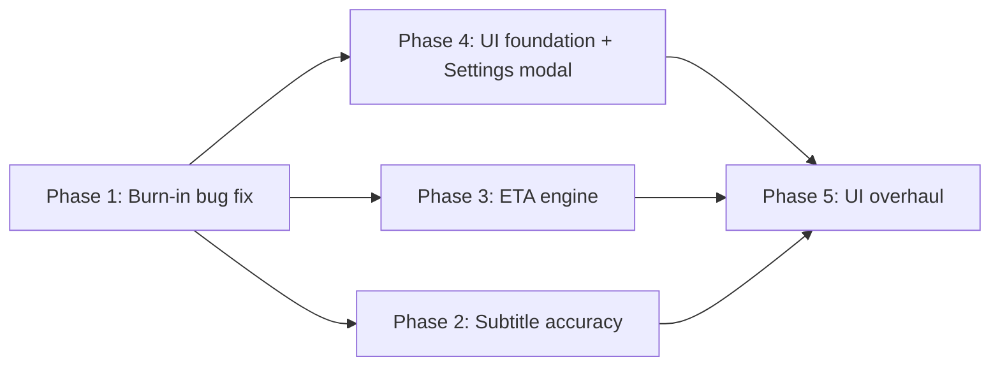

# Improvement Plan — Subtitle Accuracy, Burn-in Toggle, Settings Modal, ETA, UI

> Scope: planning only. Every root cause below was checked against the current code (2026-10-06).
> Companion docs: `plan.md` (base architecture), `optimize.md` (earlier roadmap), `prd-youtube-clip-generator.md`.

| # | Note | Type | Priority | Effort |
|---|------|------|----------|--------|
| 1 | Subtitles/karaoke inaccurate (spacing, vocabulary) | Quality | P1 | L (5–8 days, tiered) |
| 2 | "Burn-in subtitles" unchecked but subtitles still appear | **Bug** | **P0** | S (0.5–1 day) |
| 3 | Settings opens as right drawer → centered floating modal | UX | P2 | S (1–1.5 days) |
| 4 | Job ETA inaccurate | Bug + Design | P1 | M (3–4 days) |
| 5 | Modern, production-ready UI | UX/Eng | P2 | L (5–7 days) |

---

## 0. Execution Order & Tracks



- **Backend track:** Phase 1 → Phase 2 → Phase 3.
- **Frontend track:** Phase 1 (form part) → Phase 4 → Phase 5.
- Phase 5 uses the new API fields from Phase 3 (ETA range, stage timings) and Phase 2 (ASR provider settings), so it lands last.
- Same rule as before: one iteration per commit, and `test_youtube_clip_generator.py` stays green before moving on.

---

## Phase 1 — Burn-in Subtitles Toggle Bug (Note 2) · P0

### 1.1 Root cause (confirmed, 3 layers)

| Layer | Location | Problem |
|-------|----------|---------|
| Frontend | [JobForm.tsx:35](file:///d:/ProjectD/clipper_turbo/frontend/src/components/JobForm.tsx#L35), [L99-103](file:///d:/ProjectD/clipper_turbo/frontend/src/components/JobForm.tsx#L99-L103) | `burnSubtitles` is local state only. It is **never added to `formData`**, so the backend never receives it. |
| API schema | [schemas.py:26-41](file:///d:/ProjectD/clipper_turbo/backend/api/schemas.py#L26-L41) | `CreateJobRequest` has no burn-in field. |
| Pipeline | [pipeline.py:148-158](file:///d:/ProjectD/clipper_turbo/backend/pipeline/pipeline.py#L148-L158) | Always passes `subtitle_path` (YouTube VTT) and `transcript` to `render_segments`. |
| Render | [render.py:449-458](file:///d:/ProjectD/clipper_turbo/backend/pipeline/render.py#L449-L458) | Even if karaoke generation fails, it **falls back to the raw VTT**, so some subtitle is always burned. |

The checkbox is purely decorative today.

### 1.2 Fix

**Backend**
1. `schemas.py` → add `burn_subtitles: bool = Field(True, alias="burnSubtitles")` (default `True` keeps old clients and AC-6 behavior).
2. `pipeline.py`:
   - Always transcribe (the transcript is still needed for LLM segment selection).
   - If `request.burn_subtitles is False` → call `render_segments(..., subtitle_path=None, transcript=None, burn_subtitles=False)` and log `"Subtitle burn-in dinonaktifkan oleh user"`.
3. `render.py` → add an explicit `burn_subtitles: bool = True` parameter to `render_segments`. When `False`, force `clip_subtitle_path = None` before planning. This is defense in depth, so a future caller cannot reintroduce the bug by passing a transcript.
4. Persist job options: add a JSON `options` column to `Job` (`burn_subtitles`, `output_formats`, `reframe_mode`, `asr_provider`) so history/retry reproduce the same settings. Include a lightweight migration (`ALTER TABLE jobs ADD COLUMN options JSON`) in `db.py` init.
5. *(Optional, recommended)* When burn-in is off, still write a sidecar `clip_N.srt` per clip and expose it as `subtitleUrl` in `ClipInfo`. Users can then upload captions natively to TikTok/YouTube (better for platform SEO than burned text).

**Frontend**
1. `api/client.ts` → add `burnSubtitles?: boolean` to `CreateJobFormData`.
2. `JobForm.tsx` → `formData.burnSubtitles = burnSubtitles`.
3. Replace the checkbox card with a proper `Switch` component (Phase 4 primitive; plain checkbox until then).
4. Fix stale copy: the 9:16 card still says "(Center Crop)" although layout-aware reframing now exists.

**Docs**
- Amend PRD FR-9/AC-6: "burn-in subtitle **when enabled** (default on)".

### 1.3 Tests
| Test | Assertion |
|------|-----------|
| `test_schema_burn_subtitles_default_true` | Missing field → `True` |
| `test_pipeline_burn_disabled_passes_no_subtitles` | Mock `render_segments`; assert `subtitle_path=None`, `transcript=None`, `burn_subtitles=False` |
| `test_render_segments_burn_disabled_ignores_transcript` | Even with a transcript, no `.ass` written and `subtitle_burned=False` |
| `test_build_ffmpeg_command_no_subtitles_filter` | No `subtitles=` in `-vf` / `-filter_complex` (simple and complex paths) |
| Frontend unit (Vitest) | Submitting with switch off sends `burnSubtitles: false` |

### 1.4 Acceptance
- With the switch off, rendered clips contain no burned text (manual check plus the tests above).
- The job log shows "tanpa subtitle" for every clip.

---

## Phase 2 — Subtitle & Karaoke Accuracy (Note 1) · P1

### 2.1 Root causes found in the current code

| ID | Location | Problem | Symptom |
|----|----------|---------|---------|
| R1 | [transcribe.py:171](file:///d:/ProjectD/clipper_turbo/backend/pipeline/transcribe.py#L171) + [karaoke.py:197](file:///d:/ProjectD/clipper_turbo/backend/pipeline/karaoke.py#L197) | `w.word.strip()` discards Whisper's leading-space marker, then words are re-joined with `' '`. Whisper sometimes emits sub-word pieces or detached punctuation as separate "words". | **Spacing errors**: `anak - anak`, `10 . 000`, `do n't`, `Rp 50 rb`, `" kata "` |
| R2 | [karaoke.py:183-185](file:///d:/ProjectD/clipper_turbo/backend/pipeline/karaoke.py#L183-L185) | Highlights the **longest-duration word** in the block for the whole block duration. It is not time-synced. | Karaoke highlight "wrong word / not following speech" |
| R3 | [transcribe.py:156-159](file:///d:/ProjectD/clipper_turbo/backend/pipeline/transcribe.py#L156-L159) | No `language`, no `initial_prompt`/`hotwords`, no `vad_filter`, `condition_on_previous_text` left at default `True`. The model is `small` with `int8` on CPU only. | **Vocabulary errors**: names, brands, slang, and code-mixed ID/EN misheard. Language misdetected from the first 30 s. Hallucinated text in music/silence and repetition loops. |
| R4 | [transcribe.py:231-240](file:///d:/ProjectD/clipper_turbo/backend/pipeline/transcribe.py#L231-L240) | ASR always wins. **Human-uploaded YouTube subtitles** (more accurate than any ASR) are only used if ASR crashes, and they have no word timings. | Accurate creator captions are thrown away |
| R5 | Whisper word timestamps | Cross-attention timings drift ±150–300 ms, worse at segment edges. | Highlight leads or lags the voice |
| R6 | [karaoke.py:138-140](file:///d:/ProjectD/clipper_turbo/backend/pipeline/karaoke.py#L138-L140), `WrapStyle: 2` | Blocks are cut by **word count only**, ignoring punctuation, pauses, and pixel width. No-wrap mode lets long blocks overflow 1080 px. | Odd line breaks, text cut off at the frame edge |
| R7 | [karaoke.py:71-72](file:///d:/ProjectD/clipper_turbo/backend/pipeline/karaoke.py#L71-L72), [render.py:449-458](file:///d:/ProjectD/clipper_turbo/backend/pipeline/render.py#L449-L458) | A single `.ass` with `PlayResX/Y = 1080x1920` is shared by the 9:16 **and** 16:9 outputs of a segment. *(Needs verification.)* | 16:9 subtitles likely scaled or positioned wrong |

### 2.2 Solution — 4 tiers (each shippable on its own)

#### Tier A — Fix the local pipeline (free, offline) · Iteration 2.1–2.3

**2.1 Token and spacing integrity (fixes R1)**
- Keep the raw Whisper token: `{"word": w.word.strip(), "raw": w.word, "start", "end", "prob": w.probability}`.
- New `backend/pipeline/text_normalize.py`:
  - `join_tokens(tokens)`: a token whose `raw` has no leading space is **glued** to the previous token. This repairs sub-word splits and contractions.
  - Punctuation rules: no space before `, . ! ? ; : % ) ]`, none after `( [`, glue `-` inside reduplication (`anak-anak`), glue digit groups (`10.000`, `3,5`).
  - Normalize whitespace/Unicode (NFC) and collapse repeated punctuation.
- Karaoke builder renders **display words** (merged groups) instead of raw tokens. The timing of a merged word is `[first.start, last.end]`.

**2.2 Decoding quality (fixes R3)**
- `language`: resolution order is user override (new form/settings field) → yt-dlp `info["language"]` → Whisper auto-detect.
- `initial_prompt` built from the video **title + channel + chapters + top tags** (trimmed to ~200 tokens). This biases spelling of names and brands.
- `hotwords` (faster-whisper ≥ 1.0.2): a user glossary from Settings → Subtitle → "Kosakata khusus".
- `vad_filter=True, vad_parameters={"min_silence_duration_ms": 500}` removes music/silence hallucinations.
- `condition_on_previous_text=False` stops repetition loops, which pairs well with the prompt.
- Model ladder: add `large-v3-turbo` (faster-whisper ≥ 1.1) as the default **when a CUDA device is available** (`device="cuda", compute_type="float16"`). Keep `small`/`int8` as the CPU default and make it configurable in Settings with a speed/accuracy hint.
- Expose `CLIPPER_ASR_DEVICE=auto|cpu|cuda` and auto-detect via `ctranslate2.get_cuda_device_count()`.

**2.3 Forced alignment for word timing (fixes R5)**
- Optional dependency `ctc-forced-aligner` (or the WhisperX alignment module): align the final text against audio with a wav2vec2/MMS CTC model. Typical word-boundary error is < 50 ms.
- Runs **only on the selected segments** (± 1 s padding), not the full video, so the cost stays small.
- Graceful fallback to Whisper timings if the package or model is missing.

#### Tier B — Use human captions when they exist · Iteration 2.4 (fixes R4)
- `ingest.py` already downloads VTT. Distinguish **manual** subs (`subtitles`) from **auto** subs (`automatic_captions`) in yt-dlp info.
- If manual subs exist in the target language: **text from the human captions, timing from ASR/alignment**.
  - Normalize both token streams (lowercase, strip punctuation).
  - Align them with sequence alignment (`difflib.SequenceMatcher` on tokens, or Needleman-Wunsch for robustness).
  - Copy ASR timings onto matched caption words. Interpolate unmatched spans linearly between anchors.
  - If the match ratio is below 60% (wrong language or out-of-sync subs), discard and keep ASR.
- Auto-captions are never preferred over ASR (current behavior is correct there).

#### Tier C — LLM post-correction (uses existing LLM provider) · Iteration 2.5
- Runs only on the **selected segments' words** (cheap: ~150–600 words per clip).
- Prompt sends numbered words + title/glossary context. The model must return **only a JSON patch**: `[{"i": 12, "to": "Prabowo"}, {"i": 30, "merge_next": true}]`.
- Validation guard: reject the patch if it changes more than 15% of words, introduces words not near the original phonetically (Levenshtein ratio < 0.5 unless the word is in the glossary), or breaks JSON. Timings are preserved because indices stay stable.
- Toggle in Settings ("Koreksi ejaan dengan AI"), default **off** (costs tokens). Each correction is logged.

#### Tier D — Pluggable third-party ASR · Iteration 2.6
New interface `backend/pipeline/asr/base.py`:

```python
class ASRProvider(Protocol):
    name: str
    def transcribe(self, audio_path: str, *, language: str | None,
                   prompt: str | None, keyterms: list[str]) -> list[dict]: ...
```

| Provider | Why | Word timestamps | Vocabulary boosting | Notes |
|----------|-----|-----------------|---------------------|-------|
| `local` (faster-whisper) | Free, offline, default | ✅ | `initial_prompt`, `hotwords` | Current engine, improved by Tier A |
| `groq` (whisper-large-v3-turbo) | Very fast and cheap, large-v3 quality without a GPU | ✅ `timestamp_granularities=["word"]` | `prompt` | Best "upgrade without GPU" option |
| `deepgram` (Nova-3 / Nova-2) | Strong punctuation/formatting, low latency | ✅ `punctuated_word` | keyterm prompting | Check Indonesian support per model at implementation time |
| `assemblyai` (Universal) | Good accuracy, speaker labels | ✅ | key-terms / word boost | Async API (upload → poll) |
| `openai` (whisper-1) | Simple, already-familiar key | ✅ word granularity | `prompt` | `gpt-4o-transcribe` has no word timestamps, so don't use it for karaoke |

- Audio is extracted once with FFmpeg as 16 kHz mono Opus/FLAC to cut upload size about 10x.
- Keys are stored encrypted like the LLM keys (reuse `encrypt_at_rest`, same Settings → API Key tab under a new "Speech-to-Text" group).
- On provider failure, fall back to `local`, log it, and keep the job alive.
- All vendor parameter names must be **verified against current docs during implementation**.

#### Karaoke renderer rework · Iteration 2.7 (fixes R2, R6, R7)
- **Time-synced highlight:** for each phrase block, emit one Dialogue event **per active word** (same block text, the active word colored). The events are back-to-back and non-overlapping, so they keep the existing "no stacking" guarantee. Alternative: ASS `\kf` tags with `SecondaryColour`. Per-word events give exact control and are easier to test.
- **Smart chunking:** break on (in order of priority) sentence punctuation → pause ≥ 350 ms → comma → `max_words` → **max pixel width** (estimated with `PIL.ImageFont.getlength` using the bundled font, limit ~ 85% of PlayResX).
- **Per-format ASS:** generate `karaoke_{seg}_{fmt}.ass` with PlayRes matching the output (1080x1920 / 1920x1080) and a format-appropriate font size/margin.
- Bundle a font (e.g., Inter/Montserrat ExtraBold, OFL licensed) under `backend/assets/fonts` and pass `fontsdir=` to the `subtitles` filter. This gives consistent rendering on every host instead of the Arial fallback.
- `WrapStyle: 0` (smart wrap) as a safety net after width-aware chunking.

### 2.3 Measurement (required before and after)
- New `tools/eval_asr.py` plus `tests/fixtures/asr_gold/` with 6–10 short clips (ID podcast, EN interview, code-mixed, music background, fast speech). Each clip has a **hand-corrected reference** transcript and word timings.
- Metrics (via `jiwer`, dev dependency):
  - **WER / CER**
  - **Spacing error rate**: count of tokens matching `\s[,.!?%)]|\(\s|\w\s-\s\w` patterns
  - **Proper-noun accuracy**: glossary terms recognized / total
  - **Word timing MAE** vs reference (ms)
- Report table written to `storage/eval/asr_report.md`, comparing local-small, local-turbo, +alignment, +LLM-fix, and each cloud provider.

### 2.4 Acceptance
| Metric | Target |
|--------|--------|
| Spacing error rate on gold set | **0** |
| WER (local, Tier A) | ≥ 25% relative reduction vs current baseline |
| WER (best configured tier) | ≤ 10% on clean speech |
| Word timing MAE (with alignment) | ≤ 80 ms |
| Highlight sync | Active word matches the spoken word at every frame sample (manual review of 3 clips) |
| No regressions | Existing karaoke/no-overlap tests stay green |

### 2.5 Files
| File | Change |
|------|--------|
| `backend/pipeline/transcribe.py` | Raw tokens, decoding params, provider dispatch, caption-text merge |
| `backend/pipeline/text_normalize.py` | **New**: token joining and punctuation rules |
| `backend/pipeline/align.py` | **New**: forced alignment (optional dep) and caption↔ASR text alignment |
| `backend/pipeline/asr/{base,local,groq,deepgram,assemblyai,openai}.py` | **New**: provider adapters |
| `backend/pipeline/subtitle_fix.py` | **New**: LLM JSON-patch correction plus guard |
| `backend/pipeline/karaoke.py` | Per-word events, smart chunking, per-format PlayRes, fontsdir |
| `backend/pipeline/ingest.py` | Return `language`, `tags`, `chapters`, manual vs auto subtitle flag |
| `backend/api/routes/settings.py` (+schemas) | ASR provider/model/language/glossary/LLM-fix settings |
| `requirements.txt` | Optional extras: `ctc-forced-aligner`, `httpx` (if absent). Dev: `jiwer` |

---

## Phase 3 — Reliable Processing ETA (Note 4) · P1

### 3.1 Root causes (confirmed)

| ID | Location | Problem |
|----|----------|---------|
| E1 | [ingest.py:136-149](file:///d:/ProjectD/clipper_turbo/backend/pipeline/ingest.py#L136-L149) | ETA = `duration × 1.0` (CPU) or `× 0.35` (GPU) with fixed 25/45/30 splits. It ignores what actually drives cost. |
| E2 | Same | **Render cost scales with total clip seconds × formats × reframe mode**, not source duration. ASR cost depends on model/device/compute type. ASR **always** runs now (even with VTT). LLM latency, MediaPipe layout analysis, and queue wait are not modeled at all. |
| E3 | [JobProgress.tsx:31-37](file:///d:/ProjectD/clipper_turbo/frontend/src/components/JobProgress.tsx#L31-L37) | Elapsed time starts at **component mount**, not job creation. Refresh, history re-open, or late mount resets the clock. |
| E4 | [JobProgress.tsx:39-51](file:///d:/ProjectD/clipper_turbo/frontend/src/components/JobProgress.tsx#L39-L51) | `remaining = estimate − elapsed` is static and never corrected by observed speed. It hits 0 and stays at "sisa ±0". It also re-runs a **second yt-dlp probe** just for the estimate (slow and can fail). |
| E5 | [pipeline.py:79-145](file:///d:/ProjectD/clipper_turbo/backend/pipeline/pipeline.py#L79-L145) | Progress jumps through fixed milestones 10/30/55/75%. There is no intra-stage progress, so the bar freezes during the longest stages. |

### 3.2 Design — measured, self-calibrating ETA computed on the server

#### 3.2.1 Instrumentation (Iteration 3.1)
New table `job_stage_metrics`:

| Column | Example |
|--------|---------|
| `job_id`, `stage` | `…`, `transcribing` |
| `started_at`, `ended_at` | UTC timestamps |
| `work_units` | media seconds (ASR), bytes (download), clip-seconds × formats (render), prompt tokens (LLM) |
| `config_key` | `asr=small/int8/cpu`, `codec=libx264/workers=2/reframe=auto`, `llm=openrouter/llama-3.3-70b` |
| `host_key` | CPU count + GPU name (so metrics from different machines don't mix) |

Also add `started_at` and `finished_at` to `Job` (queue wait = `started_at − created_at`).

#### 3.2.2 Live intra-stage progress (Iteration 3.2)
| Stage | Progress source |
|-------|-----------------|
| Download | yt-dlp `progress_hooks` → `downloaded_bytes / total_bytes`, `speed` |
| Transcribe | faster-whisper returns a **lazy generator**. Progress = `segment.end / info.duration_after_vad`, updated each segment (throttled to ≥ 1 s). Cloud ASR: upload bytes, then indeterminate with prior. |
| Select (LLM) | Indeterminate. Uses the historical p50 latency for the provider/model as the prior. |
| Render | FFmpeg `-progress pipe:1 -nostats` → `out_time_us / clip_duration` per clip, aggregated across the worker pool (Σ done clip-seconds / Σ total clip-seconds). Layout analysis counted as a sub-step. |

`db.update_progress(job_id, stage, stage_progress)` is throttled (≤ 1 write/s) and published via the existing SSE channel.

#### 3.2.3 Prediction model (Iteration 3.3)
Per-stage **rate priors** learned with an EWMA (α = 0.3) per `(host_key, config_key)`:

```
download_s  = filesize_bytes / bw_ewma            + 3 s overhead
asr_s       = duration_s     × rtf_asr[config]     (RTF = processing s per media s)
select_s    = p50_latency[provider, model]         (+ k × transcript_tokens)
render_s    = Σ(clip_s × formats) × rtf_render[codec, reframe] / effective_workers
            + n_clips × per_clip_overhead[reframe]   (MediaPipe sampling, ASS build)
```

- **Before segment selection** the clip count is unknown. Use historical means (clips/job, clip length) for auto mode. Manual mode knows exact segments upfront.
- **After selection** recompute render_s with the real segments. This is where the biggest correction happens today.
- **Cold start** (no history): run a one-time ~10 s calibration at startup and cache it in `settings`:
  - encode 3 s of `testsrc` with the resolved codec → `rtf_render`
  - transcribe a bundled 8 s speech sample → `rtf_asr`
  - Re-calibrate when the config key changes (e.g., ASR model switched).
- `filesize_bytes` comes from the existing metadata probe (`filesize_approx`). The probe result is **stored on the job at creation** so the frontend never probes again.

#### 3.2.4 Live correction (Iteration 3.3)
For the current stage with progress `p` and elapsed `t`:

```
observed_total = t / p                          (if p ≥ 0.05)
w              = min(1, p / 0.25)               (trust observation more as p grows)
stage_remaining = w × (observed_total − t) + (1 − w) × max(0, prior_total − t)
```

- **Load factor** for future stages: `lf = clamp(observed/prior over completed stages, 0.6, 2.5)`. Future priors are multiplied by `lf`, which captures "this machine is busy right now".
- **Queued jobs**: ETA = sum of the remaining time of jobs ahead in `job_limiter` + own estimate.
- **Uncertainty range**: keep EWMA of the squared relative error per stage. Return `eta_low` (p20) and `eta_high` (p80), not a single number.
- **Display smoothing**: the ETA may decrease freely, but may increase by at most 15% per update unless a stage transition occurs. This avoids jitter.
- **Over-run**: when `elapsed > eta_high`, show "Memakan waktu lebih lama dari biasanya…" instead of "sisa 0".
- `progress_percent` = completed weighted work / total weighted work, using the **predicted stage durations** as weights instead of fixed milestones.

#### 3.2.5 API contract changes
`JobStatusResponse` gains (all optional, backwards compatible):

```jsonc
{
  "createdAt": "…", "startedAt": "…", "serverNow": "…",   // client computes elapsed from server clock
  "stage": "rendering", "stageProgress": 0.42,
  "etaSeconds": 185, "etaLowSeconds": 150, "etaHighSeconds": 240,
  "stageTimings": [{ "stage": "downloading", "seconds": 21.4 }, …],
  "queuePosition": 0
}
```

`GET /api/jobs/estimate` stays for the pre-submit preview, but uses the same model (`eta_model.predict(...)`).

#### 3.2.6 Frontend
- Remove the local `startTime`. Elapsed = `serverNow − startedAt`, ticking locally between updates (corrected on each SSE message, so clock skew is irrelevant).
- Show `~3–4 mnt lagi` (range), per-stage durations in the stepper, and an over-run message.
- Delete the second `getEstimate` call in `JobProgress`.

### 3.3 Validation
- Store `predicted_total_at_start` and `predicted_total_after_selection` on each job, then compare with the actual duration.
- `GET /api/metrics/eta` returns MAPE and the share of jobs finishing inside `[low, high]` for the last 20 jobs (also shown in Settings → Storage/Diagnostics).
- Unit tests: predictor with synthetic metrics, live-correction math, smoothing clamp, queue ETA, throttled progress writes, FFmpeg `-progress` parser.

### 3.4 Acceptance
| Metric | Target (after ≥ 5 calibrated jobs on the same host) |
|--------|------|
| MAPE of ETA at render start | ≤ 15% |
| MAPE of ETA at job start | ≤ 30% |
| Jobs finishing inside the shown range | ≥ 80% |
| Progress bar freeze | Never > 5 s without movement during download/ASR/render |
| Refresh mid-job | Elapsed/ETA unchanged after reload |

### 3.5 Files
| File | Change |
|------|--------|
| `backend/core/eta.py` | **New**: priors, EWMA store, predict, live correction, calibration |
| `backend/models/db.py` | `job_stage_metrics` table, `Job.started_at/finished_at/options/probe`, `update_progress()` |
| `backend/pipeline/pipeline.py` | Stage start/end hooks, recompute after selection, weighted progress |
| `backend/pipeline/ingest.py` | yt-dlp progress hook, return `filesize_approx` |
| `backend/pipeline/transcribe.py` | Progress callback from the segment generator |
| `backend/pipeline/render.py` | `-progress pipe:1` parsing with `Popen`, aggregated callback |
| `backend/api/schemas.py`, `routes/jobs.py` | New response fields, estimate via shared model, `/api/metrics/eta` |
| `frontend/src/components/JobProgress.tsx` | Server-clock elapsed, range display, stage timings, over-run state |

---

## Phase 4 — UI Foundation + Centered Settings Modal (Note 3) · P2

### 4.1 Current state
- [SettingsDrawer.tsx:55-57](file:///d:/ProjectD/clipper_turbo/frontend/src/components/SettingsDrawer.tsx#L55-L57) renders a right-side `aside` inside `.history-overlay` ([index.css:777](file:///d:/ProjectD/clipper_turbo/frontend/src/index.css#L777)). The content area is narrow.
- There is no focus trap, no `role="dialog"`, and no focus restore. Body scroll is not locked. Destructive actions use `window.confirm`.

### 4.2 Iteration 4.1 — Design tokens and primitives (needed by both 4.2 and Phase 5)
- Split `index.css` into `styles/tokens.css` (color, spacing, radius, elevation, z-index, motion), `styles/base.css`, and per-component CSS files.
- Primitives in `src/ui/`: `Button` (variants/sizes/loading), `IconButton`, `Dialog`, `ConfirmDialog`, `Tabs`, `Switch`, `Toast`, `Skeleton`, `Badge`, `Tooltip`.
- Icons: `lucide-react` (tree-shakable) instead of inline SVGs.

### 4.3 Iteration 4.2 — `SettingsModal`
**Structure**

```
┌──────────────────────── Pengaturan ───────────────────────── ✕ ┐
│ ┌────────────┐ ┌──────────────────────────────────────────────┐ │
│ │ ◷ Riwayat  │ │                                              │ │
│ │ ▣ Storage  │ │   Active tab content (scrolls independently) │ │
│ │ T Subtitle │ │                                              │ │
│ │ 🎙 Speech   │ │                                              │ │
│ │ 🔑 API Key  │ │                                              │ │
│ │ ⓘ Diagnost.│ │                                              │ │
│ └────────────┘ └──────────────────────────────────────────────┘ │
└──────────────────────────────────────────────────────────────────┘
```

- Built on the native `<dialog>` element with `showModal()`. This gives the top layer, the `::backdrop`, Esc-to-close, and inert background for free. A small `useDialog` hook adds focus restore to the gear button and body scroll lock.
- Size: `width: min(960px, 92vw)`, `height: min(720px, 88vh)`. Two-column layout (200 px vertical tab rail + content pane). Header stays fixed and only the pane scrolls.
- Mobile (< 640 px): full-screen sheet with horizontal scrollable tabs on top.
- Motion: backdrop fade plus panel `scale(0.97) → 1` and opacity, 160 ms ease-out. Disabled under `prefers-reduced-motion`.
- Backdrop: `rgba(5,8,15,0.6)` with `backdrop-filter: blur(6px)`. Click on the backdrop closes the modal, except when the Subtitle tab has unsaved changes (then a "Buang perubahan?" confirm appears).
- Deep link: `#settings/subtitle` opens the modal on that tab. Tab state persists in `sessionStorage`.
- Accessibility: `aria-labelledby`, `role="tablist"` / `tab` / `tabpanel` with arrow-key navigation, visible focus rings.
- Replace every `window.confirm` with `ConfirmDialog`.
- Use the extra space: the Subtitle tab gets a **live 9:16 preview frame** (mock video background with the actual font, size, position, and highlight color) next to the controls. Storage gets a usage bar chart.
- New tabs: **Speech** (ASR provider/model/language/glossary/LLM-fix from Phase 2) and **Diagnostics** (encoder, ASR device, ETA accuracy from Phase 3, backend version).
- Lazy-load the modal (`React.lazy`) to keep it out of the initial bundle.

### 4.4 Tests & acceptance
- Vitest + Testing Library: opens centered, Esc closes, focus returns to gear, Tab key cycles inside the dialog, unsaved-changes guard.
- Playwright: open from header → switch tabs → close on backdrop click (desktop + 375 px mobile viewport).
- Acceptance: settings content area at least 2× wider than the current drawer on a 1440 px screen. No layout shift of the page behind it.

---

## Phase 5 — Production-Grade UI (Note 5) · P2

### 5.1 Audit of the current UI
| Issue | Evidence |
|-------|----------|
| Narrow single column; form, progress, and results stacked | `.app-container { max-width: 960px }` |
| Many inline styles (hard to theme, blocks a strict CSP) | e.g. [JobForm.tsx:214](file:///d:/ProjectD/clipper_turbo/frontend/src/components/JobForm.tsx#L214), [L285](file:///d:/ProjectD/clipper_turbo/frontend/src/components/JobForm.tsx#L285), [JobProgress.tsx:107-110](file:///d:/ProjectD/clipper_turbo/frontend/src/components/JobProgress.tsx#L107-L110) |
| Low contrast muted text | `--text-muted #6b7280` on `#111827` ≈ 3.9:1, which fails WCAG AA for small text |
| Health check runs once at mount; no reconnection | [App.tsx:49-56](file:///d:/ProjectD/clipper_turbo/frontend/src/App.tsx#L49-L56) |
| No toasts, skeletons, empty states, or error boundary | — |
| Mixed ID/EN labels; status shown as raw enum (`selecting_segments`) | [JobProgress.tsx:202](file:///d:/ProjectD/clipper_turbo/frontend/src/components/JobProgress.tsx#L202) |
| Google Fonts loaded at runtime (privacy, offline use) | [index.css:1](file:///d:/ProjectD/clipper_turbo/frontend/src/index.css#L1) |

### 5.2 Visual direction
- Dark-first "studio" look: neutral graphite surfaces (`hsl(222 20% 7%)` → `hsl(222 16% 14%)`), one accent (electric violet `hsl(252 90% 66%)`) with a cyan support color used only for progress/live states. Semantic colors are tuned for AA contrast.
- Typography: self-hosted **Inter** (UI) + **JetBrains Mono** (timestamps, logs). Type scale 12/14/16/20/24/32 with a tight `letter-spacing` on headings.
- Elevation through layered borders (`1px hsl(… / 0.08)`) and soft shadows instead of heavy cards. 8 px spacing grid.
- Motion: 150–220 ms transitions, skeleton shimmer, a progress glow on the active stage, and hover-preview on clips. Everything respects `prefers-reduced-motion`.
- Optional light theme from the same tokens (`[data-theme="light"]`), toggled in the header.

### 5.3 Layout & components (Iterations 5.1–5.4)

**5.1 App shell**
- Sticky top bar: brand, live API status pill (polls `/api/health` every 15 s with backoff, offline banner + retry), history quick-access, theme toggle, settings.
- Workspace up to 1280 px. On ≥ 1100 px it is **two-pane**: left = job composer (sticky), right = live job + results. Stacked on mobile.

**5.2 Job composer (form)**
- URL field with a paste button. After a valid URL, show a debounced **video preview card** (thumbnail, title, duration, pre-submit ETA range from Phase 3).
- Mode as a segmented control. Auto mode shows a provider select with a "key connected" badge. Manual mode keeps the timeline editor.
- Output section: 9:16 / 16:9 as visual ratio tiles, a `Switch` for burn-in subtitles, and a subtitle style chip that opens Settings → Subtitle.
- "Advanced" disclosure: reframe mode (auto / speaker focus / split stack / center), ASR language, ASR provider override.
- Inline validation under each field. The submit button shows its loading state.

**5.3 Live job panel**
- Vertical stepper: each stage shows status icon, duration taken, and a live sub-progress bar for the current stage.
- Header: ETA range plus elapsed time, and a cancel button (backend cancel endpoint if not present: set a flag checked between stages and kill the FFmpeg/ASR subprocess).
- Human-readable status labels. `aria-live="polite"` announces stage changes.
- Log in a collapsible terminal-style panel with copy/download log.

**5.4 Results gallery**
- Responsive grid with correct aspect boxes (9:16 / 16:9). Hover or focus plays muted. Poster frame generated server-side (`ffmpeg -ss mid -frames:v 1`).
- Card: virality score ring, hook, duration, layout badge (split-stack / speaker focus), subtitle badge (karaoke / static / off).
- Actions: download, copy caption + hashtags, download `.srt` (when available), open in a new tab. Sort by score/time, filter by format.
- "Download all (.zip)" stays as the primary action. Toast confirmations.

### 5.4 Production readiness (Iteration 5.5)
| Area | Action |
|------|--------|
| Errors | React error boundary with a friendly fallback + "copy diagnostics" button. Typed API errors mapped to messages. |
| i18n | Extract strings to `src/i18n/{id,en}.ts` with a tiny `t()` hook. Default `id`. No more mixed-language labels. |
| Accessibility | WCAG 2.1 AA contrast, visible `:focus-visible` rings, full keyboard flow, labels on all inputs, 44 px tap targets |
| Performance | Lazy-load Settings, ManualTimeline, and results gallery. Bundle budget ≤ 180 kB gzip initial. Self-hosted, subset fonts with `font-display: swap`. |
| Security | Remove inline styles → enable strict CSP (`style-src 'self'`). Serve with security headers from FastAPI static mount. |
| SEO / meta | Proper `<title>`, meta description, favicon set, `theme-color`, Open Graph tags |
| Quality gates | `tsc --noEmit`, oxlint, Vitest, Playwright smoke (submit manual job with mocked API → progress → results), Lighthouse CI ≥ 90 for Performance/Accessibility/Best Practices |
| Config | API base URL from `import.meta.env.VITE_API_BASE` (default same-origin) |

### 5.5 Acceptance
- Zero inline `style=` attributes in components (lint rule).
- Lighthouse ≥ 90 on all three categories. axe-core shows 0 serious/critical issues.
- Works at 375 px, 768 px, 1280 px, and 1920 px without horizontal scroll.
- Every async action has loading, success, and error states.

---

## 6. Consolidated API & Data Changes

| Change | Phase | Backward compatible |
|--------|-------|---------------------|
| `CreateJobRequest.burnSubtitles` (default `true`) | 1 | ✅ |
| `Job.options` JSON column | 1 | ✅ (nullable) |
| `ClipInfo.subtitleUrl`, `layoutType`, `subtitleMode`, `posterUrl` | 1 / 5 | ✅ optional |
| Settings keys: `asr_provider`, `asr_model`, `asr_language`, `asr_glossary`, `subtitle_llm_fix` | 2 | ✅ |
| ASR provider keys (encrypted, reuse LLM key store with `kind="asr"`) | 2 | ✅ |
| `job_stage_metrics` table; `Job.started_at/finished_at/probe` | 3 | ✅ |
| `JobStatusResponse`: `createdAt, startedAt, serverNow, stage, stageProgress, eta*, stageTimings, queuePosition` | 3 | ✅ optional |
| `GET /api/metrics/eta`, `POST /api/jobs/{id}/cancel` | 3 / 5 | ✅ new |

---

## 7. Risks & Mitigations

| Risk | Mitigation |
|------|------------|
| `large-v3-turbo` too slow or OOM on CPU-only hosts | Only the default on CUDA. The CPU keeps `small`, the OOM ladder stays, and Groq is the "fast without GPU" path. |
| Forced-alignment models are big (≈ 300 MB+) | Optional extra, downloaded lazily, aligns only the selected segments. Falls back silently. |
| LLM correction "hallucinates" words | JSON-patch only, edit-ratio cap, phonetic similarity guard, default off, every change logged |
| Third-party ASR cost, privacy, vendor API changes | Off by default, per-provider toggle, audio-only upload (no video), adapters isolated behind `ASRProvider`, contract tests with recorded fixtures |
| ETA wrong on a fresh install | Startup calibration plus a wide range shown until ≥ 5 jobs of history exist ("estimasi kasar" label) |
| SQLite write pressure from progress updates | Throttle to ≤ 1 write/s per job. Progress kept in memory and pushed via SSE, with only stage boundaries persisted. |
| Native `<dialog>` quirks in old browsers | All modern evergreen browsers support it. A small polyfill is unnecessary for the target audience but noted. |
| UI rewrite regresses working flows | Playwright smoke suite written **before** Phase 5 changes, run on every iteration |

---

## 8. Iteration Checklist

- [ ] **1.1** Burn-in flag end-to-end (form → schema → pipeline → render guard) + tests
- [ ] **1.2** Job `options` persistence + optional `.srt` sidecar
- [ ] **2.0** ASR gold set + `eval_asr.py` baseline report
- [ ] **2.1** Token/spacing normalization (`text_normalize.py`)
- [ ] **2.2** Decoding params, language resolution, prompt/hotwords, VAD, device auto-detect
- [ ] **2.3** Forced alignment on selected segments
- [ ] **2.4** Manual YouTube captions as text source + timing transfer
- [ ] **2.5** LLM JSON-patch correction (opt-in)
- [ ] **2.6** `ASRProvider` interface + Groq / Deepgram / AssemblyAI / OpenAI adapters
- [ ] **2.7** Karaoke renderer: per-word sync, smart chunking, per-format ASS, bundled font
- [ ] **2.8** Re-run eval, publish comparison, set recommended defaults
- [ ] **3.1** Stage metrics table + timestamps
- [ ] **3.2** Live progress: yt-dlp hooks, Whisper generator, FFmpeg `-progress`
- [ ] **3.3** ETA model (priors, EWMA, calibration, live correction, range, smoothing)
- [ ] **3.4** API fields + frontend server-clock display + `/api/metrics/eta`
- [ ] **4.1** Design tokens + UI primitives + icon set
- [ ] **4.2** `SettingsModal` (native dialog, tab rail, mobile sheet, a11y, ConfirmDialog)
- [ ] **5.0** Playwright smoke suite (safety net)
- [ ] **5.1** App shell + health polling + two-pane workspace
- [ ] **5.2** Job composer redesign (preview card, switch, advanced options)
- [ ] **5.3** Live job panel (stepper, ETA range, cancel, aria-live)
- [ ] **5.4** Results gallery (posters, hover preview, badges, sort/filter)
- [ ] **5.5** Production gates (i18n, error boundary, CSP, Lighthouse, bundle budget)
